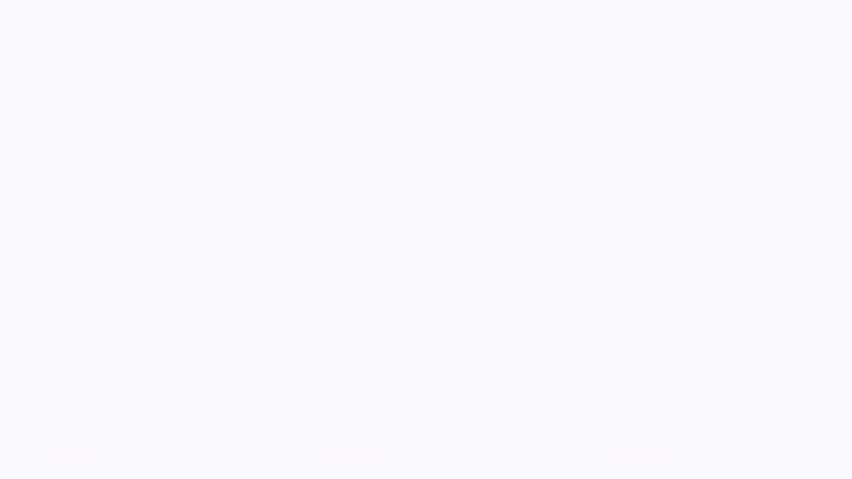

<h1 align="center">
  <a href="https://ditarr.github.io/">DiTaR: Disentangling Task-Relevant Latent Dynamics for Reward Modeling</a>
</h1>

<p align="center">
  Dayou Li<sup>1,*</sup>, Jionghao Wang<sup>1,*</sup>, Peihao Wang<sup>2</sup>, Jiuzhou Lei<sup>1</sup>,
  Hao Wang<sup>1</sup>, Jichen Chai<sup>3</sup>, Hezhen Hu<sup>2</sup>, Minghui Zheng<sup>1</sup>,
  Zhangyang Wang<sup>2</sup>, Xin Li<sup>1</sup>, Wenping Wang<sup>1</sup>, Zhiwen Fan<sup>1,†</sup>
  <br>
  <sup>1</sup>Texas A&amp;M University &nbsp; <sup>2</sup>The University of Texas at Austin &nbsp; <sup>3</sup>Georgia Institute of Technology
  <br>
  <sup>*</sup>Equal contribution &nbsp; <sup>†</sup>Corresponding author
</p>

<p align="center">
  
  <a href="https://ditarr.github.io/"></a>
</p>

<p align="center">
  This repository is the official code release for DiTaR, which turns action-free videos into dense
  rewards for robot reinforcement learning. It separates task-relevant dynamics from visual variation,
  so rewards stay stable under lighting and camera changes, yet respond when the execution is disrupted.
</p>

<p align="center">
  <a href="https://ditarr.github.io/">
    
  </a>
</p>

---

Online reinforcement learning with a **task-aware learned reward**: a WAN-TC
latent-diffusion reward model is plugged into a DrQ-v2 RL loop and trained on
image-based manipulation benchmarks — **ManiSkill** and **MetaWorld**.

The repo has two halves that plug together through a small interface:

- **`ours/` + `rl_engine/`** — the RL half (this work + a vendored DrQ-v2 engine).
- **`TSEncoder/`** — the reward *model* (the `ditar_encoder` package: latent
  encoder + flow-matching diffusion).

**This release contains the complete training code and configs for both halves.**
You train the reward model on public robot-video datasets and then train RL
against it — the full recipe is in **[`TRAINING.md`](TRAINING.md)**.

`ours/reward_models` imports the reward model **lazily**, so the RL code builds
and imports even before you have a trained reward model.

---

## What's inside

```
.
├── ours/                    # this work
│   ├── reward_models/       #   WAN-TC reward wrapper + make_rm registry + instructions
│   ├── scripts/             #   train (maniskill / shared) + reward-stats calibration
│   ├── configs/             #   Hydra configs (rl = ManiSkill, rl_shared = MetaWorld)
│   └── reward_stats/        #   precomputed (μ, σ) z-score stats per benchmark/variant
├── rl_engine/               # vendored DrQ-v2 engine + MetaWorld env factory + RND (MIT, see NOTICE)
├── maniskill_exp/           # ManiSkill env factory + task registries
├── TSEncoder/               # the reward MODEL — `ditar_encoder` (encoder + diffusion, full training code)
│   ├── configs/             #   stage1 / stage2 (warmup, alltrain) / diffusion training configs
│   ├── scripts/train.sh     #   the 4-stage training launcher
│   └── examples/smoke.sh    #   synthetic end-to-end training smoke test
├── setup.py · env.sh        # install, or just set PYTHONPATH
└── LICENSE · LICENSE-rl_engine · NOTICE · TRAINING.md · CHECKPOINTS.md · INSTALL.md
```

## The full pipeline

```
datasets ──► Stage-1 encoder ──► Stage-2 encoder ──► latent stats ──► TC diffusion ──► reward
             (task-irrelevant)   (task-relevant)                       (= reward model)  calibration ──► RL
```

Every step is a real entry point in this repo. **[`TRAINING.md`](TRAINING.md)**
walks it end to end: which datasets to download, the expected HDF5 layout, the
four reward-model training stages, how to generate the latent stats, how to
recalibrate the reward statistics, and finally how to launch RL.

## How the reward works

`ours/reward_models/wan_tc_diffusion_reward.py` exposes a `calc_reward(imgs)` API
compatible with the DrQ-v2 loop:

- **input** `imgs`: a tensor `[1, T, H, W, 3]` in `[-1, 1]` or `[0, 1]`
- **output**: a per-step reward tensor `[T]`

Internally it slides a window over the episode, computes a paired-Monte-Carlo
flow-matching x0-residual `E_t` from the diffusion model, and maps it to one of
four reward variants (then applies demo-based z-score normalization):

| `reward_type` | formula |
|---|---|
| `neg_e`       | `r_t = -E_t` |
| `exp`         | `r_t = exp(-E_t)`  ∈ (0, 1]  *(default)* |
| `td_residual` | `r_t = td_scale · (E_{t-k} - E_t)` |
| `td_exp`      | `r_t = td_scale · (exp(-E_t) - exp(-E_{t-k}))` |

The learned reward is combined with the env reward and an optional RND
exploration bonus by the DrQ-v2 loop:
`r = learned_scale · r_learned + r_env + expl_scale · r_rnd`.

## Quick start

```bash
# 1) make packages importable (either install, or just set PYTHONPATH)
source env.sh                 # simplest; or: pip install -e .

# 2) sanity check — the RL half imports without the reward model
python -c "import ours.reward_models, rl_engine.rl.drqv2.agent; print('ok')"
```

To train RL with the learned reward you need (a) a simulator
([`INSTALL.md`](INSTALL.md)) and (b) a trained reward model — train it with
[`TRAINING.md`](TRAINING.md), then point `WAN_TC_CKPT` at the result
([`CHECKPOINTS.md`](CHECKPOINTS.md) lists the env vars).

```bash
source env.sh
export WAN_TC_CKPT=/path/to/wan_tc.ckpt    # see CHECKPOINTS.md

# ManiSkill
export VK_VISIBLE_DEVICES=0 SAPIEN_VK_DEVICE_ID=0
python ours/scripts/train_drqv2_maniskill_ours.py \
  --config-path "$PWD/ours/configs/rl" --config-name default \
  task@_global_=PickCube-v1 seed=121 \
  env_reward_mode=sparse relax_success=true num_train_frames=3000000

# MetaWorld
export MUJOCO_GL=egl
python ours/scripts/train_drqv2_shared_ours.py \
  --config-path "$PWD/ours/configs/rl_shared" --config-name default \
  task@_global_=door-open-v3 seed=121 num_train_frames=3000000
```

## Reward-model boundary

The only coupling to the reward model is one **lazily-imported** line in
`ours/reward_models/wan_tc_diffusion_reward.py`:

```python
from ditar_encoder.diffusion.wan_tc_latent_diffusion_model import WanTcLatentDiffusionLAM
```

The import happens **inside** the wrapper's constructor and resolves against the
bundled `TSEncoder/` by default, so `import ours.reward_models` (and the whole
RL repo) works even without the reward model — useful for development, CI, or a
custom reward. `make_rm(cfg)` in `ours/reward_models/__init__.py` is the
registry; add your own reward there against the `calc_reward(imgs) -> [T]`
contract.

## Configuration (env vars)

Paths are not hard-coded; configs read them via `${oc.env:...}`:

| var | meaning |
|---|---|
| `REPO_ROOT` / `OURS_ROOT` | repo root / `ours` dir (set by `env.sh`) |
| `REWARD_MODEL_ROOT` | override the bundled reward model (default: `TSEncoder/`) |
| `WAN_TC_CKPT` | WAN-TC diffusion checkpoint (required to run the reward) |
| `WAN_TC_STAGE2_CKPT` | frozen TC-teacher checkpoint (optional override) |
| `WAN_TC_STATS` | latent-stats JSON for the diffusion model |
| `WAN_VAE_PATH` / `T5_PATH` | VAE / T5 (default: HF repo ids, auto-downloaded) |
| `HF_HOME` | HuggingFace cache (default `~/.cache/huggingface`) |

## License

Apache-2.0 — see [`LICENSE`](LICENSE) and [`NOTICE`](NOTICE).

`rl_engine/` (plus `maniskill_exp/`) is a vendored **MIT** subset of
[Diffusion Reward](https://github.com/TaoHuang13/diffusion_reward)
(Huang et al., 2023) and remains under its original MIT license, preserved
verbatim in [`LICENSE-rl_engine`](LICENSE-rl_engine).
